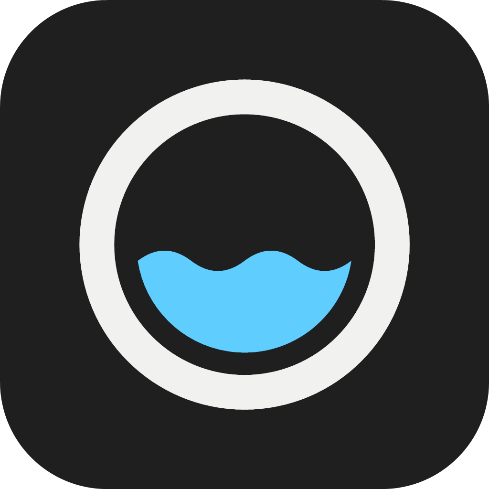

<p align="center">
  
</p>

<h1 align="center">UsageAI</h1>

<p align="center">
  <b>Every AI coding limit you're burning through — in your tray or editor.</b><br />
  Windows tray app · VS Code and Antigravity extension<br />
  Codex · Claude Code · GitHub Copilot · Google Gemini
</p>

<p align="center">
  <a href="https://github.com/VladiKogan/UsageAI/releases/latest"></a>
  <a href="https://github.com/VladiKogan/UsageAI/releases"></a>
  
  <a href="LICENSE"></a>
</p>

<p align="center">
  <a href="#-get-it"><b>Download</b></a> ·
  <a href="#vs-code-and-antigravity-extension">Editor extension</a> ·
  <a href="#-what-youll-see">What you'll see</a> ·
  <a href="#-your-credentials-stay-yours">Privacy</a> ·
  <a href="#-troubleshooting">Troubleshooting</a>
</p>

---

You're mid-refactor and the model stops. Weekly limit. Nobody told you it was close.

**UsageAI** is a tiny Windows tray app that keeps every AI coding limit you have in one glance — how much you've used, how fast you're burning it, and exactly when it resets. No dashboards to open, no logins to repeat, no surprises at 2 a.m.

<p align="center">
  
</p>

## ⚡ Get it

Current release: **UsageAI for Windows 0.14.0** and **UsageAI editor extension 0.1.17**.
You can also browse the complete **[Releases page](https://github.com/VladiKogan/UsageAI/releases)**.

| | |
| --- | --- |
| 🚀 **[UsageAI-0.14.0-Setup.exe](https://github.com/VladiKogan/UsageAI/releases/download/v0.14.0/UsageAI-0.14.0-Setup.exe)** ([SHA-256](https://github.com/VladiKogan/UsageAI/releases/download/v0.14.0/UsageAI-0.14.0-Setup.exe.sha256)) | The easy one. Start Menu shortcut, clean uninstall, and it installs the .NET 10 Desktop Runtime for you if you don't have it. |
| 🎒 **[UsageAI-0.14.0-portable.exe](https://github.com/VladiKogan/UsageAI/releases/download/v0.14.0/UsageAI-0.14.0-portable.exe)** ([SHA-256](https://github.com/VladiKogan/UsageAI/releases/download/v0.14.0/UsageAI-0.14.0-portable.exe.sha256)) | One file. No install. Drop it anywhere and double-click — it uses the [.NET 10 Desktop Runtime](https://dotnet.microsoft.com/download/dotnet/10.0) if you already have it. |
| 🧩 **[usageai-0.1.17.vsix](https://open-vsx.org/api/vladikogan/usageai/0.1.17/file/vladikogan.usageai-0.1.17.vsix)** | The VS Code and Antigravity extension. Install it from the editor's **Extensions: Install from VSIX...** command. |

Windows 10 or 11 (x64), plus at least one AI tool you're already signed in to. That's the whole setup — UsageAI reuses the login you already have, so there's nothing new to create, paste, or remember.

### VS Code and Antigravity extension

The pure TypeScript editor extension lives in [`extension/`](extension/README.md). It adds a UsageAI
Activity Bar view that can stay pinned in the Primary or Secondary Sidebar, plus an always-available
Status Bar summary. The Status Bar shows session and weekly percentages side by side; hover it for
segmented meters, the last-updated time, and quick Open/Refresh actions. One VSIX targets both VS Code
and Antigravity; marketplace publication is kept separate for Visual Studio Marketplace and Open VSX.

Install it from the [Visual Studio Marketplace](https://marketplace.visualstudio.com/items?itemName=vladikogan.usageai)
or [Open VSX](https://open-vsx.org/extension/vladikogan/usageai). For manual installation, download
the VSIX from Open VSX and select **Extensions: Install from VSIX...** in VS Code or
Antigravity. To build it from source instead:

```powershell
cd extension
npm.cmd install
npm.cmd test
npm.cmd run package:vsix
```

> Every download ships with a matching `.sha256` file if you like to verify what you run.

## 👀 What you'll see

**A tray icon that actually tells you something.** A ring that fills as you burn through your limit, the same gauge the popup draws. It stays one calm colour while you're fine, turns amber at your warning threshold (72% by default) and red at the critical one (90%), and shows `!` when no provider can be reached.

**Or every provider at once.** Set the tray icon provider to **All connected** and the icon becomes the UsageAI logo, its tank filled to the busiest limit it lists and turning amber and red at the same thresholds. Point at it for one line per provider, the same limits the popup shows:

```text
UsageAI
Codex 10% | 22%
Claude 5% | 40%
Copilot 33%
Gemini 60% | 30%
```

**Every window each provider reports — not just one number.** Codex 5-hour, weekly, credits and reset credits. Claude 5-hour, weekly, weekly Opus and extra usage. Copilot AI credits or premium requests, chat and completions. Gemini model groups (Gemini Models, Claude and GPT models) or Cloud Code API quotas.

**"At this pace, out by 15:20."** A burn-rate forecast for every limit, so you find out you're running hot *before* the wall, not after it.

**A heads-up before it matters.** Tray notifications when a limit crosses the threshold you picked — and again when it resets and you're free to go.

**Reset countdowns, plan and account** for each provider, so you always know what you're on and how long until it refills.

**The providers look like themselves.** Codex, Claude, GitHub Copilot, and Gemini carry their recognizable brand marks in the popup and dashboard, and monochrome versions coloured by the theme in the editor Status Bar.

**One glance or the full picture.** Left-click for a compact popup of ring gauges, two providers to a row; open the dashboard for one table of every limit from Codex, Claude Code, GitHub Copilot, and Google Gemini, in columns that line up — usage, what is used or left, when it resets, and where the current pace lands.

<p align="center">
  
</p>

**It never goes blank.** If a refresh fails, UsageAI keeps the last good reading and marks it **stale**, with the provider's own error message attached. The dashboard says when that good reading was captured and when the next automatic retry is due, with a **Retry** link for that provider alone; the popup dims its rings and explains on hover. Each failed provider wakes independently after its backoff, instead of waiting for the regular polling interval or hammering a rate-limited API.

**It looks like it belongs on your desktop.** Windows 11 rounded corners, context menus and slim scrollbars, native dark title bars, light/dark/follow-Windows themes, your Windows accent colour, Windows High Contrast, and window size and position remembered between runs. Gauges ease to new readings, and stay still when Windows' animation effects are off.

## 🖱️ Living in the tray

| Do this | Get this |
| --- | --- |
| Left-click the tray icon | Compact view of every connected provider |
| Point at the tray icon | Usage of the tray provider, or of every provider with **All connected** |
| **Win+Alt+U** | Same thing, from anywhere |
| Right-click ▸ **Open dashboard** | Full dashboard, all providers and metrics |
| Right-click ▸ **Settings…** | Preferences |
| Launch UsageAI again | Brings the running window forward |
| `Esc` | Back to the tray |
| `Enter` on a popup provider | Opens the dashboard |
| `Tab` / `Enter` in the dashboard | Walks its links and buttons: open a provider's usage page, copy a sign-in command, or retry one provider |

The dashboard is a normal Windows window: move it, resize it, maximize it, or close it back to the tray. It grows to fit the table, scrolls only when the table is taller than the window, and drops the forecast column on narrow windows rather than squeezing every cell.

## 🔌 Works with what you already use

| Provider | You need |
| --- | --- |
| **Codex** | Codex signed in through the Codex CLI (`codex login`) or OpenAI's Codex editor extension |
| **Claude Code** | Claude Code signed in through the CLI (`claude`) or Anthropic's Claude Code editor extension, or a Claude web session key you supply yourself |
| **GitHub Copilot** | Signed in through a Copilot IDE extension or Copilot CLI |
| **Google Gemini** | Signed in through Google's Antigravity VS Code extension, `agy` (recommended), the `gemini` CLI, or Antigravity IDE |

One is enough to get going. Connect the rest whenever you like — each provider appears as soon as it connects.

Codex and Claude Code don't need a separate CLI install: if only their editor extension is installed in VS Code, VS Code Insiders, VSCodium, Cursor, Windsurf, or Antigravity, UsageAI uses the CLI that extension ships.

## 🔒 Your credentials stay yours

UsageAI reads the login your tools already made, and nothing else:

- 🚫 **Never scans your browser storage** — no cookie extraction, ever.
- 🚫 **Never prints your credentials.** UsageAI never submits Claude's shared refresh token or rewrites
  `.credentials.json`. When Claude's short-lived access token expires—or the first usage request
  indicates that a seemingly current login is stale—UsageAI briefly runs the official
  `claude auth status --json` command and, while the stored token is still expired,
  `claude mcp list`, which makes Claude Code refresh its own login, after which UsageAI
  rereads the access token and retries usage once. Explicit environment-token overrides remain
  authoritative and are never replaced through this fallback.
- 🏠 **No telemetry or tracking.** Network access is limited to provider usage requests and
  one automatic GitHub release check per day while UsageAI is running, and checks you start manually.
- 🗑️ **Your history is yours to delete** — one button in Settings.

For Gemini, UsageAI first reuses a running Antigravity language server. If none is available, it
starts one long-lived `agy --hub` server on a loopback port and reads quota from it for the rest of
the session, so refreshes launch no child process of their own. This includes the backend
automatically installed by Google's official Antigravity VS Code extension, whose unified sign-in
keeps working after VS Code closes. Should that CLI build predate `--hub`, UsageAI falls back to a
short read-only `agy -p /usage` run with closed stdin, bounded output, and a fifteen-second deadline.
UsageAI never reads or writes Antigravity's credential store; the official CLI remains the sole owner
of that login. A failed `agy` cold start is skipped while a healthy Gemini CLI fallback remains
available. If both paths are stale, the next refresh retries `agy` immediately and keeps the last
successful snapshot visible meanwhile.

Preferences, usage history and the cached last reading live in `%LOCALAPPDATA%\UsageAI` (set `USAGEAI_DATA_DIR` to move them for a portable install). History is just timestamps, provider ids, metric names and percentages.

<details>
<summary><b>Using a Claude web session key (optional)</b></summary>

UsageAI tries Claude authentication in this order:

1. An explicitly supplied Claude web session key from `USAGEAI_CLAUDE_SESSION_KEY` (the compatible `CLAUDE_AI_SESSION_KEY` and `CLAUDE_WEB_SESSION_KEY` names also work).
2. Claude Code's saved OAuth login from its normal credential store.

The first option follows [Win-CodexBar](https://github.com/nesszer/Win-CodexBar)'s web-usage approach, but UsageAI deliberately does not extract cookies from browsers. A Claude session cookie is more privileged than a usage-only token: supply it only to the UsageAI process, keep it out of source control and scripts, and rotate it immediately if it's exposed.

For a process-scoped PowerShell session:

```powershell
$env:USAGEAI_CLAUDE_SESSION_KEY = '<your sessionKey value>'
dotnet run --project .\UsageAI.csproj
Remove-Item Env:USAGEAI_CLAUDE_SESSION_KEY
```

The key is kept in memory, is never forwarded to provider CLI child processes, and is never written to disk by UsageAI. If it's missing, invalid or no longer accepted, UsageAI quietly falls back to Claude Code OAuth.

</details>

## ⚙️ Make it yours

**Settings…** in the tray menu lets you tune:

- How often it refreshes — and whether to ease off while no window is open
- Alert thresholds, and whether resets get announced
- Theme, and where the warning and critical colours kick in
- Whether meters, headlines, the tray icon, and alert wording show quota **used** (the default) or
  **remaining** — colours and alert thresholds always follow usage
- Which metrics the full dashboard shows: all reported metrics, metered limits only, or the most
  important Session, Rolling, and Monthly limit
- Whether history is recorded, and whether the burn-rate forecast is shown
- Which provider drives the tray icon (or let it follow whichever is running hottest, or list
  **All connected** in its tooltip), which providers appear, and in what order
- Which model group the popup shows for a provider that reports several, such as Gemini
- The global hotkey, and whether UsageAI starts with Windows
- The installed desktop-app version, with manual **What's new** and **Check for updates** actions
  under **About**

After a real upgrade, UsageAI queues bundled release notes and shows them on the first time you open
the popup, dashboard, or Settings. A clean first install stays quiet. Windows High Contrast always
overrides the selected app theme, and the desktop windows rescale when moved between monitors.

UsageAI checks GitHub for a newer release once per day while it is running. You can also open
**Settings…** and use **About** → **Check for updates** at any time. The result says whether your
installed version is current, a newer version is available, or the check could not be completed.
When an update exists, UsageAI asks before downloading or installing anything; choosing **Later** leaves
the current version untouched.
Installed builds can download the matching Setup.exe, verify its published SHA-256, and ask Windows
to install it. During an in-app upgrade, Windows closes the running tray process, replaces the
executable, and reopens the updated build automatically. The first upgrade from a version released
before restart support may still require you to open UsageAI once from the Start menu; later updates
restart it automatically.

## 🩹 Troubleshooting

<details>
<summary><b>Something's not showing up</b></summary>

- **"Codex CLI was not found"** — install the Codex CLI so `codex.cmd` is on your `PATH`, set `CODEX_PATH` to its full path, or install OpenAI's Codex extension in a supported editor; UsageAI then uses the CLI it ships. (UsageAI intentionally uses `codex.cmd` rather than `codex.ps1`, so it works with the default Windows PowerShell execution policy.)
- **"Codex is not signed in"** — run `codex login` in a terminal or sign in through the Codex extension, then hit **Refresh**.
- **"Claude Code is not signed in"** — run `claude` or sign in through the Claude Code extension, or use the session-key method above, then hit **Refresh**.
- **"Google Gemini usage is unavailable"** — UsageAI tried the Antigravity IDE, the `agy` CLI, and the Gemini CLI, and the message says which of them returned nothing. Run `agy` to check that it is signed in, then hit **Refresh**.
- **"Copilot is not signed in"** — sign in through a Copilot IDE extension or Copilot CLI, then hit **Refresh**.
- **A provider says "stale"** — its latest check failed, so you're looking at its previous good reading. The dashboard shows when that reading succeeded, the provider's error, and when UsageAI will retry automatically. The retry runs independently as soon as its backoff or provider-supplied wait time expires; **Retry** beside it, or **Refresh** for every provider, checks immediately.
- **The hotkey does nothing** — another app already owns Win+Alt+U. Turn it off in **Settings…** to release it.
- **It didn't start with Windows** — open **Settings…** ▸ **General**. **Start with Windows** shows what Windows would actually do, so if it reads off with a warning underneath, Windows Startup Apps has switched UsageAI off or the entry belongs to another copy of it. Turn it on and save to repair it.
- **No tray icon** — open the Windows tray overflow menu and pin UsageAI.

</details>

<details>
<summary><b>Supplying your own tokens</b></summary>

- **Custom Claude OAuth token:** set `USAGEAI_CLAUDE_OAUTH_TOKEN` for the UsageAI process. It needs the `user:profile` scope and is never persisted.
- **Custom Copilot token:** set `COPILOT_GITHUB_TOKEN` for the UsageAI process. Used in memory only.
- **GitHub CLI fallback:** set `USAGEAI_ENABLE_GH_TOKEN_FALLBACK=1`. Off by default, because `gh auth token` can expose a broader GitHub token than usage tracking needs.

</details>

Provider protocols and usage endpoints change over time. UsageAI keeps each integration isolated in its own usage client, with response parsing covered by fixture tests, so keeping up stays cheap.

## 🛠️ Build it yourself

<details>
<summary><b>Run from source, test, and package</b></summary>

You'll need the [.NET 10 SDK](https://dotnet.microsoft.com/download/dotnet/10.0).

**Run it:**

```powershell
dotnet run --project .\UsageAI.csproj
```

**Build and test:**

```powershell
dotnet build .\UsageAI.sln -c Release
dotnet run --project .\UsageAI.Tests\UsageAI.Tests.csproj
.\scripts\verify-coverage.ps1
```

The test project is a dependency-free console harness covering credential handling, bounded I/O, provider response parsing, settings validation, history, forecasting and alert behaviour. It runs with `dotnet run`, not `dotnet test`. Run one registered check with `-- --filter "part of check name"`.

**Check one provider without the UI:**

```powershell
dotnet run --project .\UsageAI.csproj -- --diagnose codex
dotnet run --project .\UsageAI.csproj -- --diagnose claude
dotnet run --project .\UsageAI.csproj -- --diagnose copilot
dotnet run --project .\UsageAI.csproj -- --diagnose gemini
```

`--help` lists every switch; `--version` prints the build version. Diagnostic output includes account identity and usage metadata — never provider tokens, but review it before sharing publicly.

**Regenerate the screenshots:**

```powershell
dotnet run --project .\UsageAI.csproj -- --render-preview .\usageai-preview.png
dotnet run --project .\UsageAI.csproj -- --render-preview .\usageai-dashboard-preview.png --full
```

Both render at 192 DPI from sample data, with no accounts needed. Add `--quota-display remaining` for the remaining-quota view, `--theme light` or `--theme dark`, or `--dpi 96|192|288`.

**Try a window by hand** with the same sample data, at your monitor's own scale and next to an installed copy:

```powershell
dotnet run --project .\UsageAI.csproj -- --preview-window popup --theme dark --states mixed
```

`--preview-window` also takes `dashboard`, `settings`, `whatsnew`, `prompt`, `warning` and `menu`. In the popup and dashboard, **Refresh** alternates between two sets of readings, so the gauges have somewhere to move.

**Film the tray** with the whole app running on sample providers — tray icon, tooltip, popup, dashboard, Settings and alerts, with no accounts, update checks or startup registration:

```powershell
dotnet run --project .\UsageAI.csproj -- --preview-tray --theme dark
```

The tray starts on **All connected** with every limit calm. Each **Refresh** steps the readings to between the warning and critical thresholds, then past critical, then back to calm, so the tank fills and changes colour on cue. The stages aim at whatever thresholds Settings holds, and automatic polls or a refresh after sleep never change them. Exit the installed copy first so there is one UsageAI icon, and drag the new icon out of the taskbar's overflow (`^`), where Windows puts every new tray icon. **Exit** in the tray menu ends the preview.

**Build the portable executable:**

```powershell
dotnet publish .\UsageAI.csproj -c Release -r win-x64 --self-contained false -p:PublishSingleFile=true -o .\publish
```

Run `publish\UsageAI.exe`. The single-file, framework-dependent build is deliberately small and uses the installed .NET 10 desktop runtime. Rename it to `UsageAI-<version>-portable.exe` before publishing it as a release asset.

**Build the installer** — install [Inno Setup](https://jrsoftware.org/isinfo.php) 6.3 or newer, publish the portable build above, then:

```powershell
& "$env:LOCALAPPDATA\Programs\Inno Setup 6\ISCC.exe" .\installer\UsageAI.iss /DMyAppVersion=<version>
```

This produces `installer\Output\UsageAI-<version>-Setup.exe`. It installs to Program Files, adds a Start Menu shortcut and uninstaller, and silently installs the .NET 10 Desktop Runtime at install time if it's missing (see `installer\UsageAI.iss`).

**Name and checksum both Windows assets before uploading:**

```powershell
$version = '<version>'
$portable = "publish\UsageAI-$version-portable.exe"
Copy-Item 'publish\UsageAI.exe' $portable

foreach ($file in $portable, "installer\Output\UsageAI-$version-Setup.exe") {
    $hash = (Get-FileHash -Path $file -Algorithm SHA256).Hash.ToLower()
    "$hash  $(Split-Path $file -Leaf)" | Set-Content -NoNewline "$file.sha256"
}
```

Releases are built and checked locally, then uploaded manually to GitHub Releases as
`UsageAI-<version>-Setup.exe`, `UsageAI-<version>-portable.exe`, the separately versioned editor VSIX,
and their `.sha256` files. The GitHub `Build` workflow only restores, builds and tests — it never publishes.

</details>

---

<p align="center">
  <a href="https://github.com/VladiKogan/UsageAI/releases/latest"><b>⬇️ Download UsageAI</b></a> ·
  <a href="Changelog.md">Changelog</a> ·
  <a href="SECURITY.md">Security</a> ·
  <a href="LICENSE">MIT</a>
</p>
