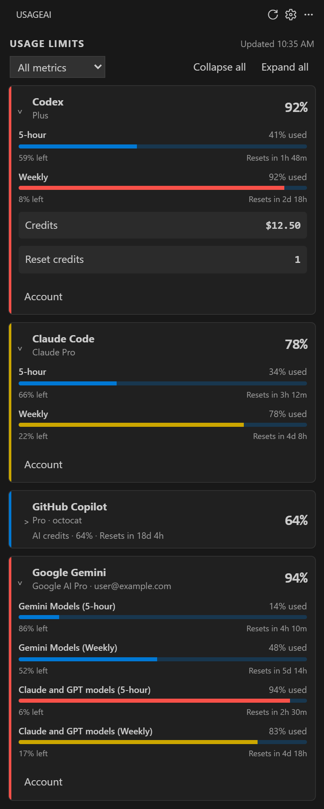
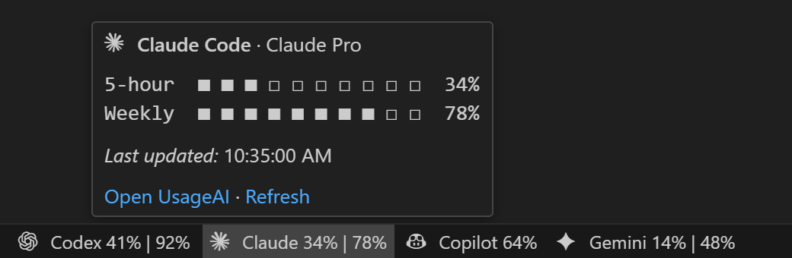

# UsageAI for VS Code and Antigravity

See how much of your Codex, Claude Code, GitHub Copilot, and Google Gemini allowance you have used—without leaving your editor.

UsageAI gives you a clear dashboard in the Activity Bar and optional Status Bar readings for the providers you care about. It uses the provider sign-ins already available on your computer, so there is no separate UsageAI account to create.

## Preview

<p align="center">
  
</p>

Open UsageAI from the Activity Bar to see each provider's usage, remaining allowance, and reset time in one place. You can also move the view to the Secondary Sidebar or Panel to match your editor layout.

<p align="center">
  
</p>

Choose one or more providers for compact Status Bar readings. Hover over a reading to see its usage windows, segmented meters, last update time, and quick links to open or refresh UsageAI.

## Install

The current extension release is **0.1.25**. Install it from the [Visual Studio Marketplace](https://marketplace.visualstudio.com/items?itemName=vladikogan.usageai) or [Open VSX](https://open-vsx.org/extension/vladikogan/usageai).

For a manual installation, download [`usageai-0.1.25.vsix`](https://open-vsx.org/api/vladikogan/usageai/0.1.25/file/vladikogan.usageai-0.1.25.vsix), then run **Extensions: Install from VSIX...** in VS Code or Antigravity.

## Get started

1. Make sure you are signed in to at least one supported AI provider.
2. Select the UsageAI icon in the Activity Bar.
3. Give the first refresh a moment to find your local provider sign-ins and load their usage.
4. Select any UsageAI Status Bar reading to reopen the dashboard.

You can also run **UsageAI: Show Usage**, **UsageAI: Refresh**, or **UsageAI: Open Settings** from the Command Palette.

## Supported providers

You only need one of these sign-in methods:

| Provider | What UsageAI looks for |
| --- | --- |
| Codex | A Codex sign-in created by `codex login` or OpenAI's Codex extension |
| Claude Code | A Claude Code sign-in created by running `claude` or Anthropic's Claude Code extension, or the optional `USAGEAI_CLAUDE_SESSION_KEY` environment variable |
| GitHub Copilot | A supported local Copilot credential, `COPILOT_GITHUB_TOKEN`, or the optional GitHub CLI fallback |
| Google Gemini | A sign-in through Google's Antigravity VS Code extension or `agy` (recommended), a Gemini CLI sign-in, or a running Antigravity language server |

For Codex, UsageAI first reads usage directly from ChatGPT with the access token of the existing
Codex sign-in, the same request the Codex CLI makes, and falls back to the CLI whenever that sign-in
has expired or the request does not succeed. UsageAI never refreshes or writes that sign-in.

For Codex and Claude Code, UsageAI runs the provider's CLI. It uses `CODEX_PATH` or `CLAUDE_PATH`
when set, then a CLI on `PATH` or in its standard install folder, and finally the CLI that ships
inside OpenAI's Codex extension or Anthropic's Claude Code extension. So having just the provider's
VS Code extension installed and signed in is enough, with one exception: on macOS, Claude Code
keeps its login in the Keychain, which UsageAI does not read, so Claude Code usage there still
needs `USAGEAI_CLAUDE_OAUTH_TOKEN` or a login saved in `~/.claude/.credentials.json`.

UsageAI requires VS Code 1.90 or newer, or a compatible Antigravity IDE build. It needs access to provider files and commands, so it does not run in vscode.dev or github.dev.

## Remote-SSH and other remote windows

In a Remote-SSH, WSL, or dev container window, UsageAI runs on your local machine by default and
shows the providers you are signed in to there. If your providers are installed and signed in on
the remote host instead, have UsageAI run there by adding this to your local user settings:

```json
"remote.extensionKind": {
  "vladikogan.usageai": ["workspace"]
}
```

Then reload the window. UsageAI reads the remote host's sign-ins and CLIs, including the CLIs
bundled with the Codex and Claude Code extensions installed on that host. Running remotely is
community-tested rather than covered by the maintainer's own testing, and GitHub Copilot may show
as not signed in there because its sign-in usually stays with your local VS Code.

## Choose what appears

The dashboard's title bar has four buttons: **Refresh**, **Accounts** (add, manage and rescan
accounts), **Open Settings**, and the **…** menu with **Choose Status Bar Items…**.

Open **UsageAI: Open Settings** to personalize the extension. The settings are in four groups:
**Providers and Accounts**, **Status Bar**, **Display** and **Refresh**.

- **Providers** enables providers and gives their starting order in both the dashboard and Status Bar.
  To arrange them, drag a dashboard card by its header (or focus it and press Alt+Up / Alt+Down).
  Each card, a second account included, goes exactly where you drop it, and the Status Bar
  follows the same order.
- **UsageAI: Choose Status Bar Items…** (also in the dashboard's **…** menu) lists every provider
  and every Claude Code and Codex account with a checkbox. Each one you tick gets its own compact
  reading, so two Claude Code accounts can sit side by side.
- The **Status Bar** settings hold a checkbox for each provider's main login. Extra Claude Code
  and Codex accounts are chosen in **Choose Status Bar Items…** only, and are not a setting.
- If nothing is chosen, **Hottest When None Selected** shows the provider with the highest current usage. Turn it off to hide UsageAI from the Status Bar.
- **Quota Display** chooses whether meters and percentages show the quota **used** (the default)
  or the quota **remaining**, in both the dashboard and the Status Bar. Warning and critical colors
  keep their meaning either way.
- **Warning Percent** and **Critical Percent** control when usage meters change color. Both are
  always measured as quota used, so the default 72% warning is the same as 28% remaining.
- **Metric Display Mode** chooses all dashboard metrics, every metered percentage limit, or the
  highest-used Session, Rolling, and Monthly limit. It does not change Status Bar readings.
- The foreground and background refresh intervals control how often readings update while the dashboard is open or hidden.

For GitHub Copilot, **Enable GitHub CLI Fallback** lets UsageAI run `gh auth token` only when it cannot use a supported local credential file. This option is off by default.

## Multiple accounts

Claude Code and Codex can show more than one account, each on a card of its own titled
"Claude Code · team". A login is a folder of its own, the one the CLI uses through
`CLAUDE_CONFIG_DIR` or `CODEX_HOME`:

- **Found automatically.** Folders in your home folder whose name starts with `.claude` (such as
  `.claude-work` or `.claude2`) that hold a `.credentials.json`, and `.codex…` folders that hold an
  `auth.json`, are found
  when the extension starts, once a day, and when you run **UsageAI: Rescan Accounts**. This is
  one listing of the home folder, never a search. On the first run the logins already there are
  shown at once; one found later is shown only after you answer **Show** (or **Ignore**).
- **Added by you.** **UsageAI: Add Account…** (also under the dashboard's **Accounts** button) either signs in
  to another account with the provider's own CLI (`claude auth login --claudeai` or `codex login`)
  in an editor terminal, into a new folder such as `~/.claude-work` that your own CLI can use
  too, or adds a login folder you already have. Added folders are saved in `usageai.accounts`.
  Each folder must be an absolute, local path that holds the credential file.
- **Managed in one list.** **UsageAI: Manage Accounts…** (also under the dashboard's **Accounts** button)
  lists every Claude Code and Codex login UsageAI knows about, including hidden, ignored and
  waiting ones, and any entry whose folder is gone or signed out. Pick one to rename it, hide or
  show it, remove one you added, or open or copy its folder. A login folder is never deleted or changed. The command writes `usageai.accounts` for
  you, so you never need to edit it by hand. You can still give an account a `label` or
  `"hidden": true` there yourself.

If adding or renaming an account says VS Code has not loaded UsageAI's account settings, the
extension was updated while the window stayed open. Choose **Reload Window** and try again.

Your main login is always the standard `~/.claude` / `~/.codex`, however the editor was started.
If it inherits `CLAUDE_CONFIG_DIR` or `CODEX_HOME`, the folder the variable names is found as one more
account instead of replacing the main one. The main login stays the primary account: the
**Status Bar** checkboxes follow it.
To put another account in the Status Bar, tick it in **UsageAI: Choose Status Bar Items…**. A login whose email and organization match an account
already shown is not added twice. Each account refreshes on its own, so an expired login goes
stale on its own card only. UsageAI reads another account's folder only: it sends that login's
token to the same Anthropic or ChatGPT endpoint as the main login's, and gives the folder to
the Claude Code and Codex commands it runs as `CLAUDE_CONFIG_DIR` or `CODEX_HOME`. Environment
overrides such as `USAGEAI_CLAUDE_OAUTH_TOKEN` and the Claude web session key apply to the
main login alone.

## Reading the dashboard

- Percentages and meter fill show how much quota has been **used**, or how much is **left** when
  **Quota Display** is set to remaining. The number and the meter always agree.
- The text under each meter shows the other side, what remains or what has been used, and when
  that limit resets.
- Providers can report more than one limit, such as a session window and a weekly window; UsageAI shows each one separately.
- Select anywhere on a provider header to collapse or expand it, or use **Collapse all** and
  **Expand all**. The preference follows the editor installation across workspaces. Stale and
  disconnected cards temporarily stay expanded so recovery details remain visible.
- If a refresh fails, the last successful reading stays visible and is marked as stale instead of disappearing. The dashboard and Status Bar distinguish that last good reading from the failed check and show the next automatic retry; retry-only checks do not disturb healthy providers or regular polling.

If a provider says it is not connected, sign in with that provider's CLI or IDE integration and run **UsageAI: Refresh**. You can use the provider card's sign-in action when one is available.

## Privacy and security

Your provider credentials stay in the extension host. UsageAI does not scan browser storage, send credentials to the dashboard webview, or include credentials in its cached usage snapshots.

Unless you turn off `usageai.showProviderIncidents`, UsageAI also reads the providers' public status pages (`status.claude.com`, `www.githubstatus.com`, `status.openai.com`) at most every five minutes, with no credential, cookie or account identifier attached, and shows an ongoing incident as a marker on the Status Bar item, a line in its tooltip, and a line on the provider's card.

Additional protections include allowlisted provider endpoints, blocked redirects, size-limited responses, read-only Claude OAuth credentials, in-memory-only refresh caching for other providers, and a local Antigravity connection reachable only over loopback. When Claude's short-lived access token expires—or the first usage request indicates that a seemingly current login is stale—the extension invokes the official `claude auth status --json` command once with bounded runtime and output—plus `claude mcp list` while the stored token is still expired, which makes Claude Code refresh its own login—rereads the credentials, and retries usage once. Claude Code remains the only process that can exchange the shared refresh token or update its credential store; explicit environment-token overrides are never replaced by this fallback. The optional Claude web session key remains an environment variable and is never saved by UsageAI.

For Gemini, the extension first reuses a running Antigravity language server, then the `agy --hub`
server Google's Antigravity editor extension runs while an editor with it is open, using that editor's
own sign-in. Only when neither answers does it start one long-lived `agy --hub` server of its own on a
loopback port and read quota from it for the rest of the session, so refreshes launch no child process
of their own. This includes the backend installed by Google's
official VS Code extension. The hub is reachable only from this machine, is gated by a token the
extension mints per session and passes to the CLI both in its environment and as `--csrf_token`, and
is stopped when the extension deactivates. Should the installed CLI predate `--hub`, the extension
falls back to a short read-only `agy -p /usage` run with stdin closed and bounded output and runtime.
A hub that fails to become ready is left alone for 30 minutes, so a refresh costs the one short
`agy -p /usage` read rather than that plus a doomed hub start; a refresh you ask for clears that wait
immediately. A failed cold start is skipped while a healthy Gemini CLI fallback remains available; if
both paths are stale, the next refresh retries `agy` immediately. Only
the process tree started by UsageAI is cleaned up. VS Code does not need to remain open after sign-in,
and UsageAI never reads or modifies Antigravity credentials.

Cached snapshots may contain usage information, reset times, plan names, and account labels so the extension can keep the last successful reading available.

## Development

Building and packaging the extension requires Node.js 22 or newer.

```powershell
cd extension
npm.cmd install
npm.cmd test
npm.cmd run test:coverage
```

Open the `extension` folder in VS Code and press `F5` to launch an Extension Development Host.

Regenerate the README previews after a dashboard or Status Bar change:

```powershell
npm.cmd run previews
```

It compiles the extension, renders the real dashboard webview and Status Bar items with sample providers in VS Code's Dark Modern colours, and captures them with headless Edge or Chrome into `media/`. Set `EDGE_PATH` or `CHROME_PATH` if the browser is not in its standard folder, and `VSCODE_CODICON_PATH` if `code` is not on `PATH`, since the view title's icons come from VS Code's own codicon font.

Package an installable artifact:

```powershell
npm.cmd run package:vsix
```

The resulting VSIX can be installed manually in both VS Code and Antigravity. Marketplace publication uses the same artifact:

```powershell
npm.cmd run publish:vscode -- --packagePath usageai-0.1.25.vsix
npm.cmd run publish:openvsx -- usageai-0.1.25.vsix
```

Publishing requires separate publisher identities and credentials for Visual Studio Marketplace and Open VSX.
